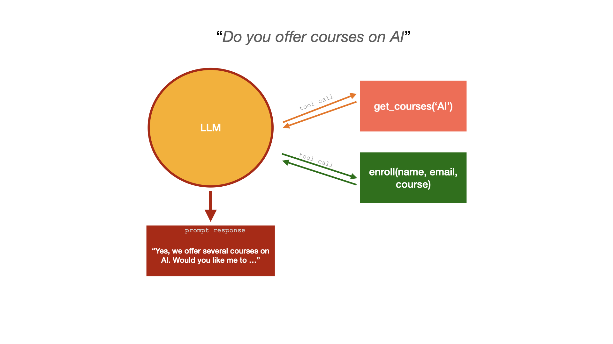

# Agentic AI Workflow Example by Salma Lalji e

[](https://www.youtube.com/@FullStackWithLawrence)<br>
[](https://platform.openai.com/)
[](https://docs.docker.com/)
[](https://www.python.org/)<br>

[](https://codecov.io/gh/FullStackWithLawrence/agentic-ai-workflow)
[](https://github.com/FullStackWithLawrence/agentic-ai-workflow/releases)
[](https://www.gnu.org/licenses/agpl-3.0)
[](https://lawrencemcdaniel.com)

A Python command-line application that demonstrates how to use OpenAI Api function calling to drive an automated agentic workflow. The app looks up courses in a MariaDB database and registers students for them. Additionally, this repo demonstrates

- how to use Docker to containerize your project, including its database
- how to leverage Pydantic for constructing complex JSON objects
- Docker debugging

Python code is [located here](./app/)



## Quick Start

The app and its database run together in one Docker container, so Docker is the only thing you need to install besides git and make.

1. Clone the repository

```console
git clone https://github.com/FullStackWithLawrence/agentic-ai-workflow.git
cd agentic-ai-workflow
```

2. Configure OpenAI API. Run `make` once to create the file `.env` in the root folder of the project, from `.env.example`. Open `.env`, add your OpenAI API key, save and close the file. See [OpenAI API Getting Started](./doc/OPENAI_API_GETTING_STARTED_GUIDE.md) for detailed setup instructions.

3. Build the Docker image, start the container, and create the course database

```console
make docker-init
```

4. Run the application

```console
make docker-run
```

## The course database

The Docker image includes a [MariaDB](https://mariadb.org/) server. `make docker-init` creates Stackademy's course catalogue in it, the database `smarter_test_db` with its 48 courses, using [scripts/create-course-database.sh](./scripts/create-course-database.sh) and [scripts/smarter_test_db.sql](./scripts/smarter_test_db.sql). These are copies of the same files in [smarter-sh/stackademy](https://github.com/smarter-sh/stackademy), which create the same database for the [Smarter](https://smarter.sh) platform.

The script also creates the read-only user `smarter_test_user`, whose password is its name. The app connects as that user to MariaDB at `127.0.0.1:3306` inside the container, which is what the `MYSQL_*` settings in `.env.example` say. Run `make docker-init` again at any time to reset the database.

To look around in the database yourself:

```console
docker exec -it agentic-ai-workflow mariadb smarter_test_db
```

## Docker commands

```console
make docker-init     # build the image, start the container, and create the course database
make docker-run      # run the application in the container
make docker-test     # run all unit tests in the container (also: make test)
make docker-coverage # run the unit tests with a coverage report, and copy out coverage.xml (also: make coverage)
make docker-start    # start the container again, e.g. after you restart Docker
make docker-build    # build the Docker image only
```

The container mounts the [app](./app/) folder, so your code changes reach it without a rebuild. Run `make docker-init` again after you change the `Dockerfile` or the requirements.

Other Docker commands

```console
make docker-push    # push your Docker container to DockerHub. A DockerHub account and DOCKERHUB_ACCESS_TOKEN is required.
make docker-prune   # prune (permanently delete) all existing data in Docker: containers, images, cache.
```

## Requirements

- [git](https://git-scm.com/book/en/v2/Getting-Started-Installing-Git). _pre-installed on Linux and macOS_
- [make](https://gnuwin32.sourceforge.net/packages/make.htm). _pre-installed on Linux and macOS._
- [OpenAI platform API key](https://platform.openai.com/).
  _If you're new to OpenAI API then see [How to Get an OpenAI API Key](./doc/OPENAI_API_GETTING_STARTED_GUIDE.md)_
- [Docker](https://docs.docker.com/): the Docker run-time environment for your operating system. Can be installed as a desktop application or as a service (daemon)
- [pre-commit](https://pre-commit.com/): _contributors only_, for `make lint`. For example, `pipx install pre-commit` or `brew install pre-commit`.

## Documentation

Documentation is available here: [Documentation](./doc/)

## Support

To get community support, go to the official [Issues Page](https://github.com/FullStackWithLawrence/agentic-ai-workflow/issues) for this project.

## Good Coding Best Practices

This project demonstrates a wide variety of good coding best practices for managing mission-critical cloud-based micro services in a team environment. Please see this [Code Management Best Practices](./doc/GOOD_CODING_PRACTICE.md) for additional details.

We want to make this project more accessible to students and learners as an instructional tool while not adding undue code review workloads to anyone with merge authority for the project. To this end we've also added several pre-commit code linting and code style enforcement tools, as well as automated procedures for version maintenance of package dependencies, pull request evaluations, and semantic releases.

## Contributing

We welcome contributions! There are a variety of ways for you to get involved, regardless of your background. In addition to Pull requests, this project would benefit from contributors focused on documentation and how-to video content creation, testing, community engagement, and stewards to help us to ensure that we comply with evolving standards for the ethical use of AI.

For developers, please see:

- the [Developer Setup Guide](./doc/CONTRIBUTING.md)
- and these [commit comment guidelines](./doc/SEMANTIC_VERSIONING.md) 😬😬😬 for managing CI rules for automated semantic releases.

You can also contact [Lawrence McDaniel](https://lawrencemcdaniel.com/contact) directly.
